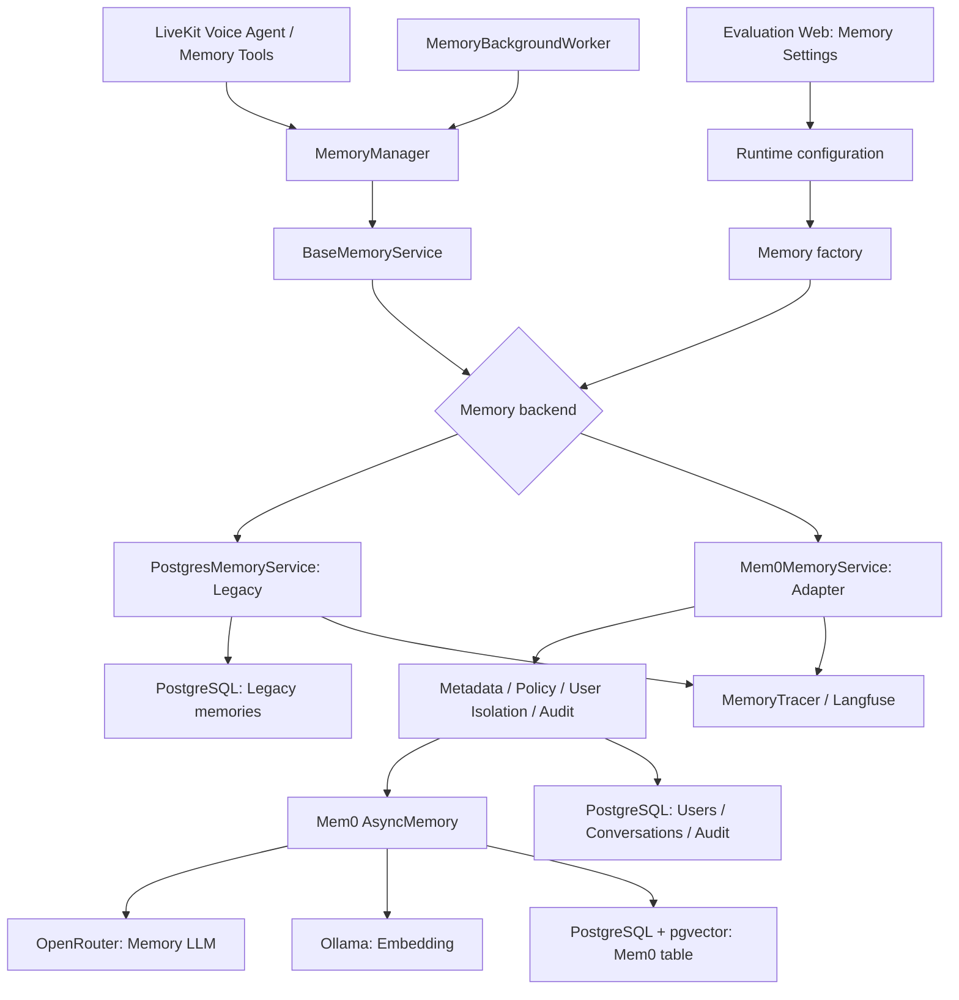

# Agent MemoryのMem0移行・評価サイト設定機能の拡張

## 1. 目的

既存のPostgreSQLベースの独自Agent Memoryを、将来の拡張性、保守性、検索品質、処理性能の改善を目的として、Mem0 OSSベースの実装へ移行してください。同時に、評価サイトのAgent設定 > メモリ画面を拡張し、Memoryのパラメータを設定・比較評価できるようにしてください。

対象リポジトリ：https://github.com/Itsuki911/Care-support-voice-agent

対象ディレクトリ：
- `Test-LiveKit/`：音声Agent、Memory、設定、DB、テスト
- `evaluation-web/`：評価・観測サイト、Agent設定

## 2. 基本方針・制約

- Mem0 OSS（`mem0ai`）をPythonライブラリとして導入する。Mem0のマネージドクラウドサービスは使用しない。
- 既存のローカルPostgreSQLおよびpgvectorを継続利用する。Docker / Docker Composeを必須にしない。
- 既存の `BaseMemoryService` を利用し、Agent本体、Memory Tools、Workerへの変更を最小限にする。
- 現在の記憶管理の仕様・API・データ形式を原則維持する。Mem0標準機能で不足する部分だけ互換レイヤーで補う。
- 既存の独自実装を比較評価・ロールバック用に残し、設定で切り替え可能にする。
- 将来的なGCP Cloud SQL for PostgreSQLへの移行を考慮する。今回はクラウド移行を実施しない。
- 音声応答のリアルタイム性を維持し、自動抽出・統合・保存を音声応答経路から分離する。
- **Rerankerは導入しない。Memory用の関連ライブラリ・処理・パラメータ・UIは追加しない。既存RAG側の機能は本件の変更対象外とする。**
- Mem0のバージョンを固定する。公式ドキュメントと採用バージョンのソースコードを確認し、API、対応プロバイダー、検索スコア、履歴ストア、抽出・統合方式を検証してから実装する。未対応の設定を有効に見せるだけのUIは作成しない。
- APIキー、DBパスワード、接続先等の認証・インフラ情報は環境変数や既存の秘密情報管理に置く。

## 3. 現行仕様の維持

以下は既存の `MEMORY_README.md`、`memory_tools.py`、`memory/factory.py` 等に基づく維持対象。実装時に現行コードを再確認し、差異があれば既存挙動を優先する。

- セッション開始時、直近の記憶を最大5件（既存のハーネス設定に従う）System Promptに追加する。
- 通常の会話では毎ターン自動検索せず、ユーザーの明示的な要求に応じて `search_memories` / `list_recent_memories` を実行する。
- 明示的な保存要求には `save_memory` による即時保存を行う。
- デフォルトではセッション終了時に会話から重要な記憶を非同期で抽出・保存する。既存の各回答後の抽出モードも維持する。
- 記憶タイプ：`preference`、`habit`、`profile`、`interest`、`event`、`topic`、`fact`。
- 重要度、信頼度、有効期限、作成・更新日時、ソースセッション、バージョン、監査履歴を維持する。
- ユーザー単位の記憶分離、重複抑止、矛盾の処理、ADD / UPDATE / DELETE / NOOPに相当する既存の意味的挙動を維持する。
- 一時的な発言、挨拶、仮定、第三者の情報、根拠のない推測は原則保存しない。明示保存も既存の認可・保存ルールに従う。
- DB、Embedding、Memory LLM等の障害時も会話を継続できるようにする。保存失敗を成功として報告しない。

## 4. 技術スタック

| レイヤー | 採用技術・方針 |
|---|---|
| Agent Framework | LiveKit Agents（既存） |
| Memory Engine | Mem0 OSS / `mem0ai`（新規） |
| Memory API | `AsyncMemory`（採用版で検証） |
| Database | PostgreSQL（既存） |
| Vector Store / Index | pgvector / HNSW（対応設定・検索性能を検証） |
| Embedding | Ollama / `embeddinggemma-2:270m`（既存、出力次元768を実測確認） |
| Memory LLM | OpenRouter（既存モデルを初期値として継承） |
| ORM / Driver | SQLAlchemy 2.x / psycopg 3（既存）、Mem0の必要依存関係のみ追加 |
| DB Migration | Alembic（既存） |
| Background Processing | asyncio / MemoryBackgroundWorker（既存） |
| Observability | MemoryTracer / Langfuse（既存の観測経路に統合） |
| Evaluation / Test | DeepEval、pytest、既存ベンチマーク |
| Evaluation Web | Next.js / TypeScript（既存） |
| Future DB | GCP Cloud SQL for PostgreSQL（将来） |

## 5. Agent Memoryアーキテクチャ

### 5.1 Mem0MemoryServiceとバックエンド切替

`memory/services/mem0_memory_service.py` 等に `BaseMemoryService` の新しい実装を追加する。

- 既存の `search_memory`、`search_memory_safe`、`add_memory`、`get_memory`、`update_memory`、`delete_memory`、`list_memories`、`list_conversation`、`process_conversation` 等に対応する。
- `MemoryRecord`、`MemorySearchResult`、`ProcessConversationResult` 等の既存モデルを返す。Mem0内部形式をAgent側に漏らさない。
- `memory/factory.py` と `MemoryRuntime` を共通インターフェースで扱えるようにし、`memory_backend=postgres`（既存独自実装）/ `mem0`（新実装）で切り替える。
- 既存の `MemoryManager`、`MemoryTools`、`MemoryBackgroundWorker` を再利用する。
- Mem0の非同期APIでも内部I/Oがイベントループをブロックしないか確認する。必要な場合はブロッキング処理を隔離する。
- 同一ユーザーへの並行更新、再試行、二重登録を考慮する。既存のユーザー単位ロック等を必要に応じて維持する。

### 5.2 Memory LLM

対話用LLMとMemory LLMはモデルを共通化できるが、**推論処理は分離する**。自動記憶抽出・統合はバックグラウンドで行う。

以下の2つのモードを評価サイトから選択できるようにする。

| `memory_llm_mode` | 挙動 |
|---|---|
| `inherit` | 対話用LLMと同じモデル・プロバイダーを使用する。ただし記憶管理用のプロンプトによる独立した推論を行う。 |
| `independent` | Memory専用のプロバイダー、モデルを指定する。対話用LLMと独立して精度・速度・コストを最適化する。 |

既存Memory LLMの挙動を維持するため、初期値は `independent` とし、現在の設定値を継承する。`inherit` は設定された対話モデルを採用時に解決し、Memory側の温度・出力上限等は独立して設定可能にする。

明示保存や既存データ移行は、Mem0の `infer=False` 相当の直接保存APIを使用し、不必要な再抽出を行わない。自動抽出の無効化時も明示保存は利用可能とする。

### 5.3 記憶抽出・統合・検索

- 原則としてMem0の記憶抽出、重複管理、検索、CRUDを利用する。
- 抽出用プロンプトには既存の保存ポリシーを反映する。Memory Type、重要度、信頼度等の構造化情報を既存モデルと互換の形で扱う。
- Mem0採用版が既存のADD / UPDATE / DELETE / NOOPと異なる統合方式の場合、必要な独自Consolidation処理を残す。Mem0の自動書込みを制御できない場合は、既存の抽出・統合判断を通して直接保存する方式も検討し、二重処理やポリシー違反を防止する。
- 重要度・信頼度・種類・期限等のルールは、可能な限り永続化前に適用する。Mem0の標準設定でないものはアプリ側で実装する。
- 検索はpgvectorによるセマンティック検索とユーザー・メタデータフィルターを使用する。スコアの定義（距離か類似度か）を検証し、既存の `similarity_score` と閾値の意味を保つ。
- 期限切れの記憶を検索・プロンプト注入から除外し、直近記憶は更新日時順に取得する。必要に応じて過剰取得後の絞り込みを行う。
- 明示要求時検索をデフォルトとする。毎ターン検索は比較評価用のオプションとし、遅延・コストを計測する。

## 6. DB設計・データ移行

既存PostgreSQL内にMem0専用テーブル（例：`mem0_memories`）を作成し、現行テーブルと分離する。実際のテーブル名・スキーマはMem0のpgvector設定に合わせる。

| テーブル | 役割 |
|---|---|
| `users` | 既存ユーザー管理 |
| `conversations` | 既存会話履歴 |
| `memories` | Legacy Memoryおよび移行元・比較用データ |
| `memory_history` | 既存監査履歴を維持 |
| `mem0_memories` | Mem0の記憶・ベクトル・メタデータ |
| ID対応・追加メタデータ用テーブル（必要時） | 旧IDとMem0 IDの対応、既存形式との互換情報 |

- Mem0 OSSの履歴ストアが既存PostgreSQL監査と異なる場合も、PostgreSQL側の監査を維持する。既存 `memory_history` の外部キーがLegacy IDを前提とする場合は、監査スキーマを安全に拡張し、Mem0 IDとの整合性を確保する。
- `user_id`、Memory Type、importance、confidence、source_session_id、version、created_at、updated_at、expires_at、Embeddingモデル・次元を保持する。Mem0が直接保持できない情報はメタデータや補助テーブルで管理する。
- 既存記憶を再抽出せずに移行し、旧IDと新IDの対応、件数、内容、メタデータ、ユーザー分離を検証する。
- 移行はバックアップ、dry-run、再実行可能な処理、移行結果レポートを備える。旧テーブルを破壊しない。
- 比較評価ではバックエンド別のデータを分離し、同一の初期状態を用意する。本番切替後の新規記憶がLegacy側に自動で反映されるとは限らないため、ロールバック時の差分同期・復元方針を明示する。
- Embeddingモデル変更時は同一次元でもベクトル互換性を仮定しない。別コレクションまたは再Embeddingを実行し、完了後に切り替える。
- Mem0の内部履歴、テレメトリ、外部送信の挙動を確認し、介護向けデータの不要な外部送信を防ぐ。LLMへの必要な送信も既存のデータ取扱方針に従う。

## 7. 評価サイト：Agent設定 > メモリ

既存のAgent設定画面と同じデザイン、設定保存方式、入力検証、エラー表示を採用する。基本設定、LLM、検索、Embedding、抽出、統合、記憶管理の各セクションに整理する。現在の記憶タイプ別件数・最近の履歴表示も維持し、選択中のバックエンドに対応させる。

以下の推奨初期値は実測による最適値ではない。既存実装に対応設定がある場合はその値を優先して引き継ぎ、異なる場合は評価用候補として扱う。

### 7.1 基本設定

| パラメータ | 推奨初期値 | 内容 |
|---|---|---|
| `memory_backend` | `mem0`（移行検証完了後） | `postgres` / `mem0` の切替 |
| `extraction_frequency` | `session_end` | `session_end` / `every_response`（既存） |
| `auto_extraction_enabled` | `true` | 自動記憶抽出の有効化 |
| `auto_consolidation_enabled` | `true` | 自動記憶統合の有効化 |
| `search_mode` | `on_demand` | `on_demand` / `every_turn` |

`memory_enabled` と `memory_prompt_recent_limit` は既存のハーネス設定を維持する。設定値を二重管理しない（Memory画面への参照表示や移設を行う場合も単一の設定ソースを使用）。

### 7.2 Memory LLM設定

| パラメータ | 推奨初期値 | 内容 |
|---|---|---|
| `memory_llm_mode` | `independent` | `inherit` / `independent` |
| `llm_provider` | `openrouter` | プロバイダー（対応済みのもののみ） |
| `llm_model` | 現在のMemory用モデル | Memory用モデル（inherit時は解決されたモデルを表示） |
| `temperature` | `0.0` | 記憶判断の安定性 |
| `max_tokens` | `2048` | 最大出力トークン数 |
| `timeout_seconds` | `30` | LLM処理の制限時間 |
| `custom_instructions` | 既存抽出ルール | 保存対象・除外対象等の記憶抽出プロンプト |

`inherit` 選択時は独立モデルの入力を無効化し、実際に使用されるモデルを明示する。モデルごとに対応するパラメータを検証する。

### 7.3 Memory Retrieval設定

| パラメータ | 推奨初期値 | 内容 |
|---|---|---|
| `top_k` | `5` | 最大取得件数 |
| `threshold` | `0.3`（既存閾値を優先） | 関連度の下限 |
| `search_timeout_seconds` | `3` | 検索処理の制限時間 |
| `metadata_filter` | `null` | Memory Type等の検索条件 |

`threshold` はスコアの定義を統一した後に利用する。既存検索ツールの明示的なlimitと設定値の優先順位を定義し、既存の上限・認可を維持する。ユーザー指定フィルターで `user_id` の分離条件を上書きできないようにする。

### 7.4 Embedding設定

| パラメータ | 推奨初期値 | 内容 |
|---|---|---|
| `embedding_provider` | `ollama` | Embeddingプロバイダー |
| `embedding_model` | `embeddinggemma-2:270m` | Embeddingモデル |
| `embedding_dimension` | `768`（実測確認） | 出力次元数 |
| `embedding_timeout` | 既存設定値 | 処理の制限時間 |

RAGのEmbeddingとは設定を分離する。モデル・次元変更は通常の保存操作と区別し、再Embeddingまたは新コレクションの作成を要求する。次元は実モデルの出力に一致させ、任意の変更を許可しない。

### 7.5 Memory Extraction設定

| パラメータ | 推奨初期値 | 内容 |
|---|---|---|
| `infer` | `true` | 自動処理でのLLM記憶抽出 |
| `min_importance` | `0.5` | 自動保存する重要度の下限 |
| `min_confidence` | `0.8` | 自動保存する信頼度の下限 |
| `max_memories_per_extraction` | `10` | 1回の自動抽出件数上限 |
| `allowed_memory_types` | 全7種類 | 自動保存するMemory Type |
| `user_messages_only` | `true` | ユーザー発言を記憶の根拠に限定 |

`infer=false` を生の会話に適用して全発言を直接保存しない。自動推論を停止する場合は自動抽出をスキップするか、別途抽出済みの検証済み情報だけを直接保存する。明示保存・移行の直接保存は別経路とする。

### 7.6 Memory Consolidation設定

| パラメータ | 推奨初期値 | 内容 |
|---|---|---|
| `deduplication_enabled` | `true` | 重複排除 |
| `deduplication_threshold` | `0.90` | 重複候補判定の閾値 |
| `contradiction_detection` | `true` | 矛盾検出 |
| `auto_update_enabled` | `true` | 記憶の自動更新 |
| `auto_delete_enabled` | `false` | 矛盾等による自動削除 |

これらはMem0標準パラメータであるとは限らない。採用版で対応しない場合は互換レイヤーで制御する。既存挙動と異なる初期値は比較評価用とし、意図しない仕様変更を行わない。自動削除の無効化は、ユーザーの明示削除要求や正当な削除処理を妨げない。

### 7.7 Memory Lifecycle設定

| パラメータ | 推奨初期値 | 内容 |
|---|---|---|
| `default_ttl_days` | `null` | デフォルト有効期間（nullは無期限） |
| `max_memories_per_user` | `null` | ユーザーごとの記憶保存上限 |
| `exclude_expired_memories` | `true` | 期限切れ記憶を検索対象から除外 |
| `audit_history_enabled` | `true` | 監査履歴の保存状態 |

介護向けAgentのため、期限・上限による自動物理削除は今回実装しない。上限到達時は新規自動保存の拒否等を明示し、黙って既存記憶を消さない。期限除外・監査は実運用では必須とし、無効化を許す場合は隔離された評価環境に限定する。監査を一般ユーザーが無効化できないようにする。

### 7.8 UI・設定反映・検証ルール

- 選択肢、トグル、数値入力、プロンプト用テキストエリアを使用し、既存の他設定画面のスタイルに合わせる。
- 0〜1の値、整数、上限、モデル互換性、JSONフィルター等をクライアントとサーバーの双方で検証する。
- Mem0標準設定、アプリ側互換設定、固定または再構築が必要な設定を区別する。
- 未対応・未実装のパラメータは無効化し、理由を表示する。設定保存に成功してもAgent側で使用されない状態を作らない。
- 既存 `.agent-runtime-config.json` の `memory` セクションを拡張し、既存設定ファイルとの後方互換性を保つ。部分更新で他セクションや既存キーを消さない。
- 設定は原則として次回セッション開始時から適用する。現在のセッションで使用中の設定を途中変更しない。再起動や再Embeddingを要する場合は明示する。
- 既存のハーネス設定によるMemory無効化を最優先する。非対応の組み合わせは検証時に拒否する。
- 設定変更が実行時のMemory LLM、Embedding、検索、抽出、統合の動作に反映されることをテストする。
- HNSWの構築パラメータ、接続情報、認証情報は一般のAgent設定画面に追加しない。

## 8. 観測・評価

既存のMemoryTracer、Langfuse、DeepEval、評価サイトを利用して、LegacyとMem0を同じデータ・条件で比較する。Rerankerは使用しない。

### 8.1 Trace / Sessionに記録する情報

- 実行時のMemoryバックエンド、Mem0バージョン、実際に使用したLLM・Embeddingモデル、Memory設定のスナップショットまたは設定バージョン。
- 抽出・統合・検索・保存の処理時間、ステータス、エラー、検索件数、保存件数、ADD / UPDATE / DELETE / NOOP相当の結果。
- Memory LLMの入力・出力トークン数、取得可能な実測コスト。取得できない値をゼロとみなさず未計測として扱う。
- 音声応答経路への影響、バックグラウンド処理の失敗・タイムアウト・キュー溢れ。
- 既存のデータ取扱方針に従い、認証情報や不要な個人情報をログや設定スナップショットに含めない。

### 8.2 評価指標

| 評価項目 | 内容 |
|---|---|
| Retrieval Quality | Precision@K、Recall@K、必要な記憶の取得成功率 |
| Extraction Accuracy | 正しい記憶の抽出、不要な記憶・推測の保存防止 |
| Consolidation Accuracy | 重複排除、矛盾処理、更新・削除の適切さ |
| Memory Latency | 検索、抽出、統合、保存のp50 / p95 |
| Voice Response Latency | 音声応答・初回音声出力への影響 |
| Token Usage / LLM Cost | Memory処理単独の消費トークン・費用 |
| User Isolation | 他ユーザーの記憶取得・更新・削除が発生しないこと |
| Metadata / Audit Integrity | 記憶タイプ、重要度、信頼度、期限、履歴の整合性 |
| Reliability | 障害時フォールバック、再試行、並行処理、再起動後の整合性 |

既存の `scripts/benchmark_memory.py` を拡張または再利用する。両バックエンドの初期データ、対話履歴、モデル、検索条件を統一し、設定値変更による影響も評価する。Mem0への変更だけで性能向上を仮定しない。

## 9. 主な変更対象

| ファイル・ディレクトリ | 変更内容 |
|---|---|
| `Test-LiveKit/pyproject.toml` / lockfile | Mem0と必要依存関係を追加・固定 |
| `Test-LiveKit/memory/interfaces/` | 既存インターフェース維持、必要最小限の変更 |
| `Test-LiveKit/memory/services/` | Mem0MemoryService、互換処理 |
| `Test-LiveKit/memory/factory.py` | バックエンド・設定に応じた初期化 |
| `Test-LiveKit/database/` | 設定モデル、DB接続・互換データ管理 |
| `Test-LiveKit/migrations/` | 追加テーブル・監査互換性等のマイグレーション |
| `Test-LiveKit/workers/memory_worker.py` | 既存非同期処理維持、必要時のみ改善 |
| `Test-LiveKit/memory_tools.py` | 既存Tool仕様の維持、設定反映 |
| `Test-LiveKit/agent.py` / 関連ランタイム | 設定の実行時適用・トレース連携（必要箇所のみ） |
| `Test-LiveKit/memory_dashboard.py` | バックエンド別件数・履歴取得 |
| `Test-LiveKit/.agent-runtime-config.json` | Memory設定の永続化形式（実行時生成ファイルの扱いを尊重） |
| `evaluation-web/app/config/agent/settings-view.tsx` | Memory設定UI |
| `evaluation-web/app/config/agent/runtime-data.ts` | Config型・初期値・読み込み・ダッシュボード連携 |
| `evaluation-web/app/config/agent/actions.ts` | サーバー側検証・保存 |
| `Test-LiveKit/tests/` | 単体・結合・回帰テスト |
| `Test-LiveKit/scripts/` | データ移行・性能比較 |
| `Test-LiveKit/MEMORY_README.md` | セットアップ、設定、運用、移行・復旧手順 |

実際のファイル構成を確認し、既存の設定読込実装など適切な箇所を修正する。無関係な機能のリファクタリングは行わない。

## 10. 導入Step

1. **既存仕様・公式API調査**：既存コード、テスト、Runtime設定とMem0採用版を確認する。現在のテスト・ベンチマークを実行し、基準値を記録する。設定項目とAPIの対応表を作成する。
2. **依存関係追加・接続検証**：Mem0を導入し、ローカルPostgreSQL/pgvector、Ollama、OpenRouterと疎通する。AsyncMemory、Embedding次元、検索スコア、履歴保存を確認する。
3. **Adapter・互換レイヤー実装**：Mem0MemoryServiceを追加し、既存インターフェース、記憶ポリシー、監査、ユーザー分離、非同期Workerに統合する。
4. **DB・移行処理**：Mem0専用テーブル、必要なメタデータ・監査スキーマを用意する。dry-run可能な既存データ移行スクリプトを実装し、テストDBで検証する。
5. **Factory・Runtime設定**：バックエンド切替、Memory LLMのinherit/independent、各設定の実行時反映を実装する。移行検証が済むまでは既存バックエンドをデフォルトにする。
6. **評価サイト拡張**：Memory設定画面を実装し、設定の入力検証、永続化、適用状態、メモリ件数・履歴の表示を確認する。
7. **観測・評価**：設定スナップショット、Memory処理トレースを追加し、既存実装との回帰・性能・品質・コスト比較を実施する。
8. **切替・ドキュメント**：受入条件を満たした後にMem0を標準候補とする。実データの移行・本番切替はバックアップと承認を前提とする。ロールバック手順を整備する。

### 実装優先順位

- P0：バックエンド切替、既存仕様互換、抽出頻度、Memory LLMのモード・モデル・temperature、top_k、threshold、抽出プロンプト、設定反映、回帰テスト。
- P1：Embedding設定、重要度・信頼度、記憶種類、抽出上限、重複判定、検索モード、設定スナップショット、詳細な観測。
- P2：TTL・保存上限の追加設定、詳細フィルター、矛盾・更新・削除のチューニング。既存の期限管理・監査・ユーザー分離自体はP0で維持する。

## 11. 完了条件・提出報告

- 既存AgentのMemory関連機能および音声応答が回帰テストを通過する。
- 両バックエンドが利用可能で、設定したバックエンドが実際に使用される。
- `inherit` / `independent` の両方で意図したモデルがMemory用の独立した推論に使われる。
- 明示保存・検索、直近記憶取得、自動抽出、更新、削除、履歴が既存仕様に従う。
- PostgreSQLへの保存、再起動後の取得、既存データ移行、ID対応、ユーザー分離、期限・監査の整合性を検証する。
- 評価サイトから対応済みパラメータを変更でき、実行時に反映される。未対応設定を隠さず報告する。
- 音声応答の遅延やMemory失敗時の挙動を測定する。性能が悪化した場合は原因・改善案を報告し、無条件に切り替えない。
- Reranker関連のMemory機能・設定が追加されていない。
- テスト結果、実測比較、変更ファイル、実行コマンド、残課題、導入・ロールバック手順を報告する。未実施の検証や未対応機能を完了扱いにしない。

## 12. 参考資料

- Mem0公式ドキュメント：https://docs.mem0.ai/
- Mem0公式リポジトリ：https://github.com/mem0ai/mem0
- 既存Memory設計：https://github.com/Itsuki911/Care-support-voice-agent/blob/main/Test-LiveKit/MEMORY_README.md
- 既存Memory factory：https://github.com/Itsuki911/Care-support-voice-agent/blob/main/Test-LiveKit/memory/factory.py
- 既存Memory Tools：https://github.com/Itsuki911/Care-support-voice-agent/blob/main/Test-LiveKit/memory_tools.py
- 既存評価サイトのAgent設定：https://github.com/Itsuki911/Care-support-voice-agent/tree/main/evaluation-web/app/config/agent

Mem0の設定名・API・対応機能はバージョンに依存する。上記のパラメータ名は評価サイト側の設定スキーマ案であり、すべてがMem0ネイティブの設定名であることを意味しない。採用版の公式仕様と実際の動作を確認し、必要な変換や互換処理を実装すること。
