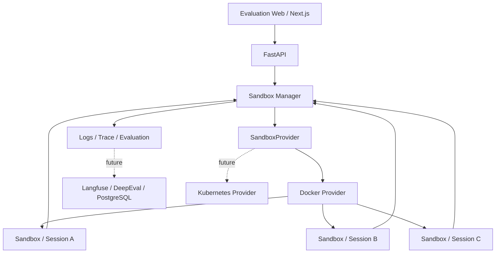
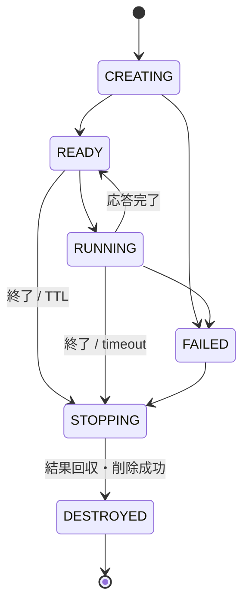

# Agent Evaluation Sandbox — 技術選定・実装仕様書

- 決定日: 2026-11-26
- 対象: Voice Agent Lab / evaluation-web
- ステータス: 基本方針決定、Level 1 実装前
- 本書は設計仕様であり、実装済み機能を示すものではない。

## 1. 目的と制約

評価サイトから AI Agent を起動し、会話・実験・安全性評価を、本番環境から分離した実行環境で行えるようにする。LangSmith Sandboxes に近いセッション単位の実行管理を目指す。

| 項目 | 決定事項 |
|---|---|
| 開発環境 | ローカルで開発し、将来 GCP へ移行 |
| 予算 | ローカル実行基盤は原則無料・OSS（LLM 利用料を除く） |
| 対象 | 自身が開発する複数種類の Agent |
| 将来の実行対象 | Python Agent、MCP、RAG、Memory |
| 並列数 | 2〜5 セッション |
| ライフサイクル | 会話セッションごとに生成・破棄 |
| 開発方式 | OSS を組み合わせた独自基盤 |
| 初期目標 | シンプルな Agent を動かす Skeleton。後から拡張・技術再選定可能にする |

Agent 全体を Sandbox 内で実行する。評価・観測・実行管理は原則 Sandbox 外に置く。初期段階は自作の信頼済み Agent のみを対象とし、任意コード実行サービスとして公開しない。

## 2. 技術スタック

| 技術 | 採用時期・用途 |
|---|---|
| Next.js | 既存 evaluation-web を継続利用 |
| FastAPI | Level 1: 管理 API |
| Python 3.12 | Level 1: Manager・サンプル Agent（依存関係に応じ調整可） |
| Docker Engine / Docker SDK for Python | Level 1: コンテナ生成・操作 |
| 独自 Sandbox Manager / Provider | Level 1: 実行基盤の抽象化 |
| asyncio / Semaphore | Level 1: 単一 Manager 内の並列制御 |
| Docker Compose | Level 1: ローカルサービス構成 |
| gVisor (runsc) | Level 2: Linux 上で隔離強化 |
| PostgreSQL | 必要になった段階で状態永続化。既存 DB との統合を検討 |
| Langfuse / DeepEval | 既存評価設計に従い段階的に接続 |
| GCP / GKE / Kubernetes Agent Sandbox | Level 4 候補。移行時に再評価 |

初期実装では Redis、Celery、Kubernetes、E2B、Daytona、Firecracker の直接実装は不要。Docker Desktop はライセンス条件を確認する。Mac では Colima 等も選択可能。gVisor は Linux が必要であり、Mac/Windows では Linux VM 等で互換性を検証する。

## 3. アーキテクチャ



- UI は Docker API に直接接続しない。
- Manager はセッション ID と Sandbox ID の対応、ライフサイクル、制限、結果回収を管理する。
- Agent は独立コンテナ内の長寿命 Runner プロセスで実行する。
- 同じ会話セッションでは同じ Agent インスタンスを維持する。別セッション間で状態を共有しない。
- Level 1 は Mock LLM / Mock Tool によるオフライン実行。RAG・MCP・Memory の実サービス接続は後続段階。
- Docker デーモンへのアクセスは信頼済み Manager に限定する。Agent には Docker ソケットやホスト認証情報を渡さない。

## 4. 推奨ディレクトリ構成

既存リポジトリの実装・命名規則を調査し、重複するバックエンドがあれば再利用する。以下は新設する場合の推奨構成であり、既存ファイルの移動を要求しない。

```text
Care-support-voice-agent/
├── evaluation-web/
│   ├── app/                         # 既存 UI
│   └── SANDBOX_SPEC.md
├── evaluation-backend/
│   ├── api/
│   │   └── sandbox.py
│   ├── sandbox/
│   │   ├── manager.py
│   │   ├── provider.py
│   │   ├── models.py
│   │   ├── policy.py
│   │   └── providers/
│   │       └── docker.py
│   ├── runtime/
│   │   ├── runner.py
│   │   └── protocol.py
│   └── tests/
│       └── test_sandbox.py
├── sandbox-images/
│   └── python-agent/
│       ├── Dockerfile
│       ├── requirements.txt
│       └── sample_agent.py
└── docker-compose.yml
```

Compose の既存構成がある場合は別ファイルまたは安全な追記とする。

| コンポーネント | 責務 |
|---|---|
| manager.py | セッション管理・並列制御・タイムアウト・回収 |
| provider.py | ランタイム共通インターフェース |
| providers/docker.py | Docker SDK の具体実装 |
| models.py | 設定・状態・入出力モデル |
| policy.py | 許可イメージ・リソース・実行ポリシー |
| runtime/runner.py | Sandbox 内の Agent 呼び出し |
| runtime/protocol.py | JSON 入出力・メッセージ識別 |
| api/sandbox.py | UI 向け API |

## 5. Provider と実行プロトコル

以下はインターフェースの設計例。具体的な型は Pydantic 等で定義する。

```python
class SandboxProvider:
    async def create(self, config): ...
    async def start(self, sandbox_id): ...
    async def send_message(self, sandbox_id, message): ...
    async def get_status(self, sandbox_id): ...
    async def get_logs(self, sandbox_id): ...
    async def stop(self, sandbox_id): ...
    async def destroy(self, sandbox_id): ...
```

Docker SDK は同期 I/O を含むため、asyncio.to_thread 等を利用して API イベントループをブロックしない。後から Docker Provider のランタイム設定を runsc に変更できるようにする。利用できないランタイムへの暗黙のフォールバックは禁止する。

Level 1 は永続 Runner の stdin/stdout を attach 等で接続する方式を優先する。exec を使う場合も同一 Agent プロセスへの IPC とし、発話ごとに Agent を再初期化しない。TTY は無効にし、stdout のプロトコルと stderr のログを分離する。外部ポートを公開しない。

JSON Lines の例（各メッセージは一行）:

```json
{"type":"message","request_id":"req-1","content":"Hello"}
{"type":"response","request_id":"req-1","content":"Hello!","status":"ok"}
```

起動準備完了の ready イベント、エラーイベント、相関 ID、最大入力・出力サイズを定義する。Agent 出力は信頼しないデータとして検証する。同一セッション内のメッセージは直列化する。生のコマンド、任意イメージ名、マウント設定等を UI から指定させない。

## 6. API と UI の最小仕様

以下の API パス・レスポンスは実装用の提案であり、既存 API 規約に合わせて調整可能。

| Method | Path | 用途 |
|---|---|---|
| POST | /api/sandboxes | 許可済み Agent を指定しセッション生成 |
| GET | /api/sandboxes/{id} | 状態取得 |
| POST | /api/sandboxes/{id}/messages | 会話メッセージ送信・応答取得 |
| GET | /api/sandboxes/{id}/logs | サイズ制限付きログ取得 |
| POST | /api/sandboxes/{id}/stop | 停止 |
| DELETE | /api/sandboxes/{id} | 破棄（冪等） |

セッション識別子は推測困難な ID とし、対象コンテナの ID は Manager が解決する。失敗は構造化エラーで返し、スタックトレースや認証情報を UI へ露出しない。並列上限時は 429 等の明確な応答を返す。

既存 Next.js のデザインを維持し、Sandbox の開始、状態表示、メッセージ入力・応答表示、ログ表示、終了操作を最小画面として追加する。実行結果を合成データで偽装しない。既存の Agent 設定・実験画面への本格統合は後続段階。

## 7. ライフサイクル



- 起動失敗、OOM、タイムアウト、切断、停止要求でも確実にクリーンアップする。
- 削除失敗時は DESTROYED にしない。エラーを記録して再試行する。
- コンテナに管理用ラベル、セッション ID、作成時刻を付与する。
- Manager 再起動時は管理ラベル付きの孤立コンテナを検出し、安全に回収する。無関係なコンテナを削除しない。
- 初期はインメモリ状態管理・単一 Manager プロセスで実装。Semaphore はコンテナ寿命全体を通じて確保し、破棄確認後に解放する。複数ワーカーや分散管理は後続段階。
- ログ・結果の回収は時間と容量を制限し、秘密情報をマスキングする。

## 8. 初期設定とセキュリティ

以下の数値は検証用の初期値であり、実測に基づき調整する。

| 項目 | 初期値 |
|---|---|
| CPU | 1 vCPU / Sandbox |
| メモリ | 512 MiB / Sandbox |
| 最大並列 | 3（設定で最大 5） |
| 生存時間 TTL | 30 分 |
| アイドル TTL | 5 分 |
| 応答時間上限 | 120 秒 |
| ネットワーク | 無効（network_mode=none） |
| ファイルシステム | read-only root + 容量制限付き tmpfs |
| 実行ユーザー | non-root |
| Linux capabilities | 原則全削除 |
| 権限昇格 | no-new-privileges |
| プロセス数 | pids_limit で有限値に制限 |
| ホスト共有 | 禁止 |
| privileged / host PID / host network | 禁止 |
| コンテナ終了後 | コンテナ・専用一時データ破棄 |

Docker 標準 seccomp 等を無効化しない。既知のローカルビルド済みイメージだけを許可し、依存バージョンを固定する。管理 API はローカル限定で公開し、ブラウザからのアクセスも許可オリジン・認証等で制限する。Docker デーモンの権限が強いことを理解し、Manager の入力検証を必須とする。

Docker 単体は悪意のある任意コードに対する十分な隔離境界ではない。Level 1 では実際の介護データや本番 DB、実 API キーを使わない。Mock LLM / Mock Tool で動作確認する。実 LLM 接続を追加する際は管理された egress / API Gateway、用途別認証、コスト上限を設計し、Sandbox に本番権限を付与しない。

## 9. 開発順序

### Level 1 — Skeleton（今回）

1. 既存コード・バックエンド・Docker 設定を調査する。
2. サンプル Agent と Runner を作成し、単体コンテナでオフライン会話を検証する。
3. Provider・Docker Provider・Policy・Manager を実装する。
4. FastAPI と UI を接続する。
5. ライフサイクル、制限、並列、異常時回収の統合テストを実施する。
6. ローカル起動手順・制限事項・実測結果を README 等へ記録する。

### Level 2 — Secure Sandbox（後続）

gVisor / runsc、ネットワークポリシー、LLM API Gateway、秘密情報管理、権限制御、異常検知を追加。対象ホストでの互換性・隔離性能・負荷を検証する。

### Level 3 — Agent Evaluation Sandbox（後続）

複数 Agent の登録、カスタムテンプレート、MCP・RAG・Memory のテスト環境、DeepEval / Langfuse、A/B テスト、設定バージョン管理、必要に応じスナップショット・永続化を追加する。

### Level 4 — GCP（候補）

GKE と Kubernetes Agent Sandbox を再評価し、Kubernetes Provider を追加する。実行キュー、分散並列制御、Warm Pool、永続ストレージ、オートスケーリングを必要に応じ採用する。クラウド費用・ネットワーク・IAM は移行時に別途設計する。

## 10. Level 1 完了条件

以下は未実施の受け入れテスト項目。

- [ ] UI から Sandbox を生成し、実際に Python Agent が起動する。
- [ ] 同一セッションで複数ターンの会話履歴が保持される。
- [ ] 別セッション間で履歴・一時データが漏れない。
- [ ] Agent の応答・実ログが UI に表示される。
- [ ] 2〜5 の設定可能な並列実行が動作し、上限超過が拒否される。
- [ ] CPU・メモリ・プロセス数・実行時間の制限を検証できる。
- [ ] 外部通信、ホストマウント、権限昇格、Docker ソケットアクセスが許可されない。
- [ ] root ファイルシステムへの書き込みが拒否され、一時領域だけが使用できる。
- [ ] 起動失敗、異常終了、タイムアウト、アイドル TTL の後に孤立コンテナが残らない。
- [ ] セッション終了と重複削除要求で安全に破棄できる。
- [ ] Manager 再起動後に管理対象の孤立コンテナを回収できる。
- [ ] 既存 UI の build / typecheck と新規バックエンドのテストが成功する。
- [ ] LLM API キーなしでローカル再現できる。

テストでは正常系だけでなく、並列競合・異常終了・制限超過も確認する。Docker が利用できない環境で統合テストをスキップした場合は、その事実を報告する。

## 11. 参考資料と未検証事項

- [LayerX の参考記事](https://zenn.dev/layerx/articles/a99cd11af487fc)
- [Docker SDK for Python](https://docker-py.readthedocs.io/)
- [Docker Engine security](https://docs.docker.com/engine/security/)
- [gVisor](https://gvisor.dev/)
- [Kubernetes Agent Sandbox](https://github.com/kubernetes-sigs/agent-sandbox)
- [Colima](https://github.com/abiosoft/colima)
- [既存 evaluation-web README](./README.md)

現時点では技術選定と基本仕様を決定した段階であり、既存 Agent の依存ライブラリ・Docker/gVisor の互換性、リアルタイム音声通信、隔離性能は未検証。Level 1 の対象にはリアルタイム音声通信を含めない。API パス、JSON プロトコル、詳細なエラー処理、ディレクトリ配置は本書を実装可能にするための提案であり、既存構成と整合する範囲で調整する。調整内容は実装時に記録する。
